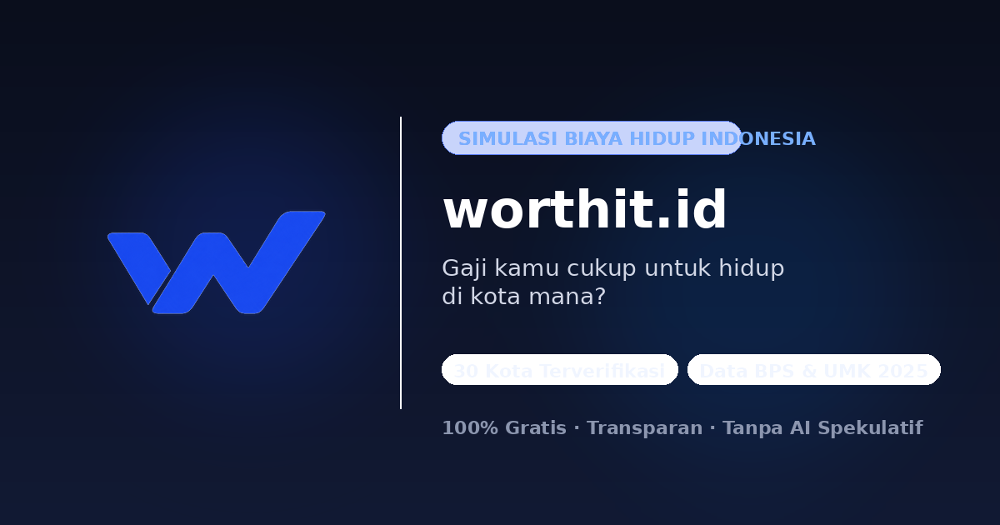

<div align="center">

# 🇮🇩 WorthIt.id
### Gaji kamu cukup untuk hidup di kota mana?

[](https://opensource.org/licenses/MIT)
[](https://react.dev/)
[](https://www.typescriptlang.org/)
[](https://vitejs.dev/)
[](https://tailwindcss.com/)
[](https://pages.cloudflare.com/)

<p align="center">
  Platform simulasi biaya hidup deterministik, kalkulator target gaji (reverse salary), dan simulator tawaran kerja luar kota (phantom raise detector) di 30 kota Indonesia berdasarkan data resmi BPS & UMK 2025.
</p>

---



</div>

---

## ✨ Fitur Unggulan

- **📊 Kalkulator Biaya Hidup 30 Kota**: Menghitung estimasi pengeluaran per kategori (tempat tinggal, pangan, komuter, utilitas, cicilan) dengan visualisasi cincin tabungan (*Apple-style gauge ring*).
- **🎯 Target Gaji (Reverse Calculator)**: Tentukan target sisa tabungan bersih bulanan dan gaya hidup; sistem menghitung berapa tawaran gaji kotor (*Gross*) dan *Take Home Pay* yang wajib dinegosiasikan.
- **💼 Simulator Tawaran Kerja (Job Offer & Phantom Raise)**: Deteksi otomatis apakah kenaikan nominal gaji ke kota lain justru membuat tabungan defisit akibat lonjakan biaya sewa hunian kota tujuan.
- **🚚 Estimasi Modal Relokasi**: Hitung modal awal pindah kota (tiket transportasi, logistik angkut barang, uang muka sewa kost, deposit, dan dana darurat 1–6 bulan *runway*).
- **⚖️ Perhitungan Pajak PPh 21 TER (PP 58/2023) & BPJS**: Simulasi potongan BPJS Ketenagakerjaan (JHT 2% + JP 1%), BPJS Kesehatan (1%), serta PPh 21 tarif efektif rata-rata untuk status PTKP `TK/0` hingga `K/3`.
- **🌙 Dark Mode & Light Mode**: Dukungan tema visual terintegrasi dengan preferensi OS pengguna.
- **📱 Responsif & PWA-Ready**: Tampilan rapi di semua resolusi smartphone dan tablet dengan kontrol segmented ala iOS.
- **📷 Shareable WorthIt Card**: Unduh ringkasan hasil evaluasi dalam format gambar resolusi tinggi untuk media sosial dan dokumen PDF rapi.

---

## 🏛️ Integritas Data (Terverifikasi & Transparan)

Semua angka acuan berbasis data resmi yang dapat diverifikasi publik tanpa fabrikasi atau estimasi AI spekulatif:

1. **Badan Pusat Statistik (BPS)**:
   - Survei Biaya Hidup (SBH)
   - Indeks Harga Konsumen (IHK) 150 Kabupaten/Kota
   - Pengeluaran Rata-Rata Per Kapita Sebulan (September 2025)
2. **Kementerian Ketenagakerjaan RI**:
   - Keputusan Gubernur terkait Upah Minimum Kota/Kabupaten (UMK) Tahun 2025 di 30 kota.
3. **PT PLN (Persero)**:
   - Tarif dasar listrik reguler golongan R-1 (non-subsidi).
4. **Listing Pasar Hunian Terbuka**:
   - Observasi sewa kost dan apartemen per area distrik (Q4 2025).

---

## 🚀 Memulai (Local Development)

Proyek ini dibangun menggunakan arsitektur Single Page Application (SPA) murni dengan package monorepo:

### Prasyarat
- Node.js `>= 18.x`
- npm `>= 9.x`

### Instalasi
```bash
# Clone repositori
git clone https://github.com/FIQTOR/worthit.id.git
cd worthit.id

# Install seluruh dependensi workspace
npm install

# Build shared calculation engine
npm --workspace=@worthit/shared run build

# Jalankan development server
npm run dev
```

Buka [http://localhost:5173](http://localhost:5173) di browser.

---

## 🧪 Pengujian & Typecheck

```bash
# Jalankan test suite unit kalkulasi finansial
npm run test

# Jalankan typecheck TypeScript
npm run typecheck

# Build produksi
npm run build
```

Hasil build statis akan siap di folder `dist/`.

---

## ☁️ Deployment ke Cloudflare Pages

Aplikasi ini 100% *client-side static SPA* dan siap di-deploy secara gratis dengan bandwidth unlimited di Cloudflare Pages:

1. Buat project baru di dashboard **Cloudflare Pages** > **Connect to Git**.
2. Pilih repositori **`FIQTOR/worthit.id`**.
3. Masukkan konfigurasi build:
   - **Framework preset:** `Vite` (atau `None`)
   - **Build command:** `npm run build`
   - **Build output directory:** `dist`
   - **Root directory:** `/`
4. Klik **Save and Deploy**. Aturan redirect SPA sudah otomatis dikonfigurasi melalui `dist/_redirects`.

---

## 🗺️ Cakupan 30 Kota Indonesia

| Wilayah | Kota |
|---|---|
| **Jawa** | Jakarta, Surabaya, Bandung, Yogyakarta, Semarang, Malang, Surakarta, Bogor, Depok, Tangerang, Tangerang Selatan, Bekasi, Cirebon |
| **Sumatera** | Medan, Batam, Pekanbaru, Palembang, Bandar Lampung, Padang |
| **Kalimantan** | Balikpapan, Samarinda, Pontianak, Banjarmasin |
| **Sulawesi** | Makassar, Manado |
| **Bali & Nusa Tenggara** | Denpasar, Mataram, Kupang |
| **Maluku & Papua** | Ambon, Jayapura |

---

## 📄 Lisensi

Didistribusikan di bawah lisensi terbuka **MIT License**. Lihat file [`LICENSE`](LICENSE) untuk rincian selengkapnya.

---

<div align="center">
  Dibuat dengan ❤️ untuk transparansi finansial dan perencanaan karir pekerja Indonesia.
</div>
